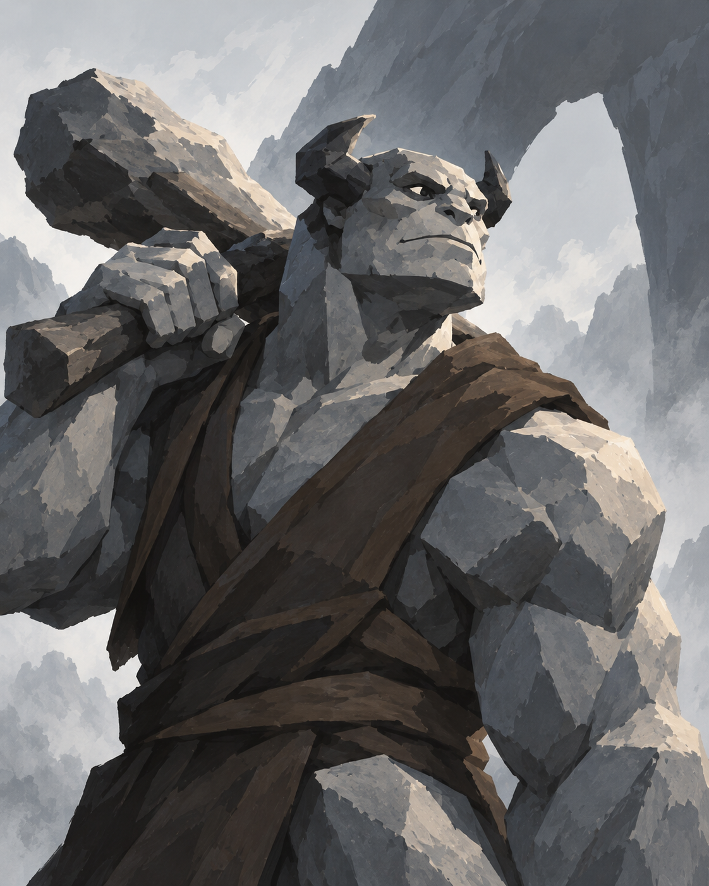
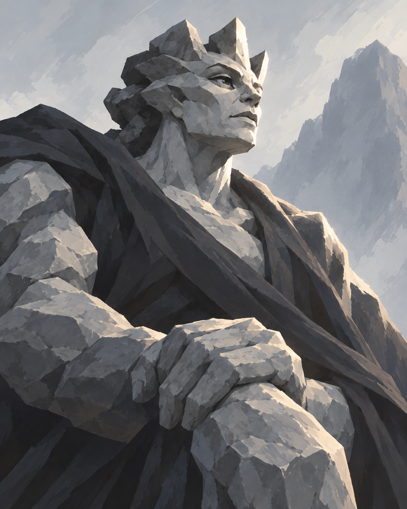
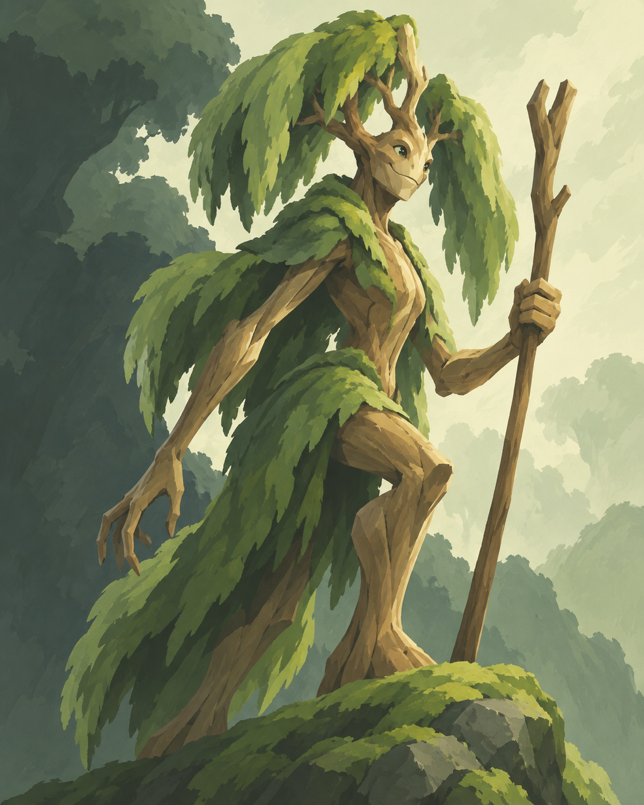
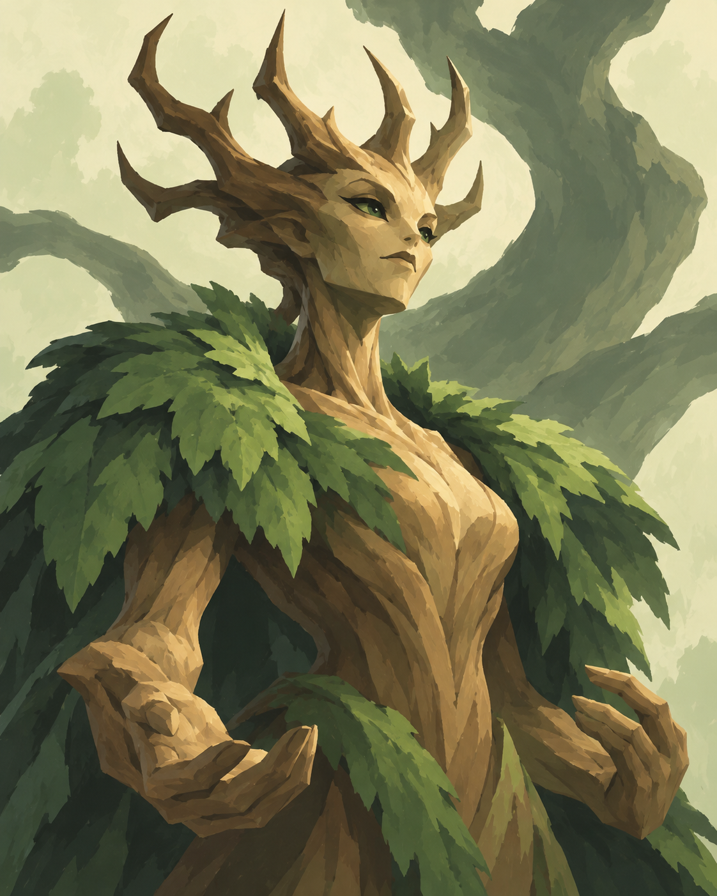
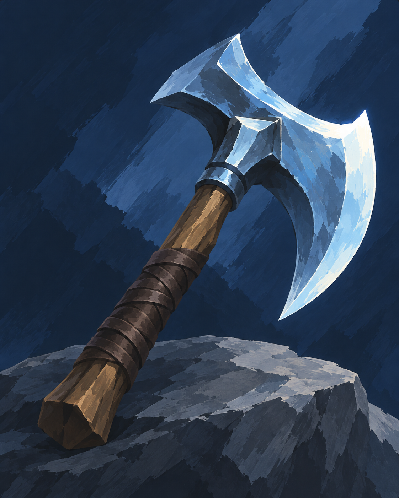
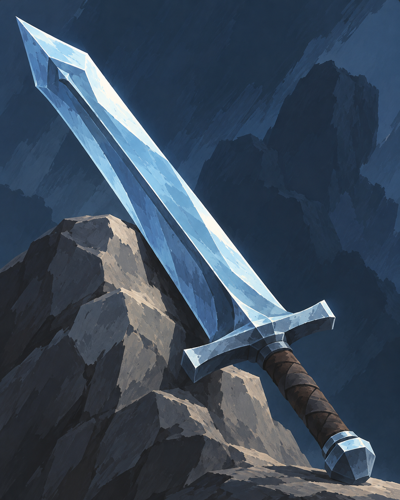
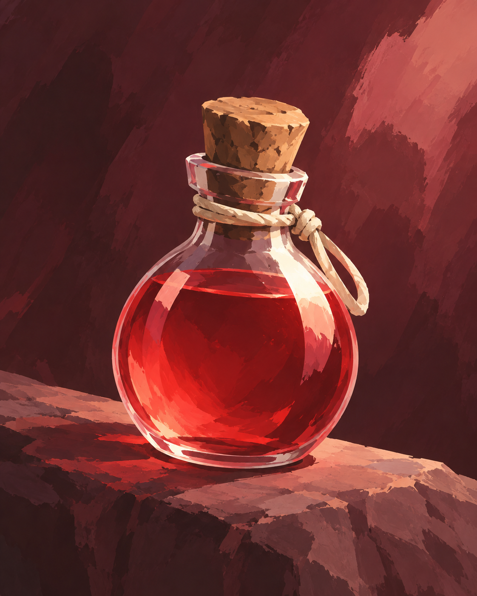
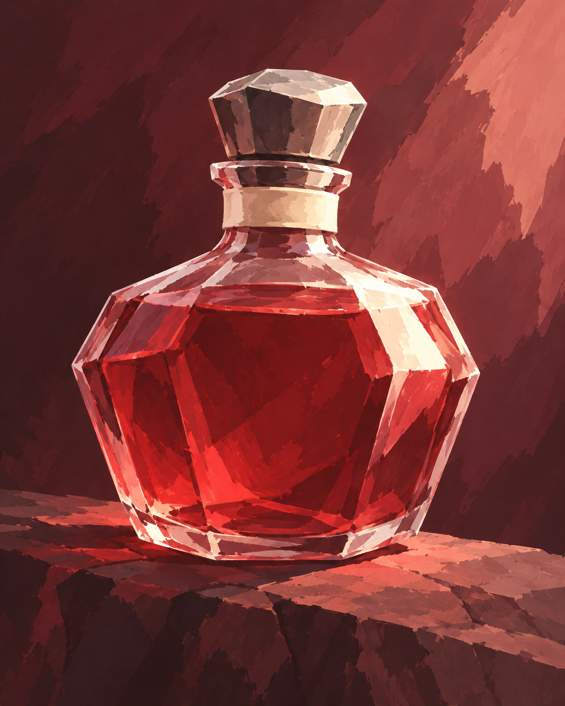

# Ash & Briar

Selected by the user from [palette concept 02](../palette-concepts/ash-and-briar.png) on 2026-10-22. This set contains all 44 proposed names and eight independently generated sample illustrations. It has not been applied to the playable deck.

Spades are **Stonekin** in slate and charcoal. Clubs are **Treefolk** in fern and cream green. Diamonds are blue-steel weapons. Hearts are healing potions with red liquid at every rank. The paintings use broad shapes, simple silhouettes, limited props and quiet backgrounds.

## Full naming set

Linked names have sample illustrations.

| Rank | Spades · Stonekin | Clubs · Treefolk | Diamonds · Weapons | Hearts · Potions |
| --- | --- | --- | --- | --- |
| 2 | Pebble Sneak | Sproutling | Steel Shiv | Mender's Sip |
| 3 | Flint Scout | Bramble Scout | Frostfang | [Rosehip Tonic](samples/3h.png) |
| 4 | [Shale Sentry](samples/4s.png) | [Willow Watcher](samples/4c.png) | [Rime Axe](samples/4d.png) | Hearth Cordial |
| 5 | Cobble Brawler | Hazel Guard | Warden's Spear | Scarlet Draught |
| 6 | Slate Warden | Birch Warden | Cobalt Mace | Heartroot Brew |
| 7 | Cairn Keeper | Rootbound Shaman | Moonsteel Saber | Ruby Elixir |
| 8 | Basalt Brute | Oak Sentinel | Glacier Maul | Lifeblood Tonic |
| 9 | Quarry Breaker | Thornback | [Skycleaver](samples/9d.png) | [King's Remedy](samples/9h.png) |
| T | Obsidian Knight | Ironbark Champion | Winter's Edge | Second Dawn |
| J | Flint Marshal | Briar Marshal | — | — |
| Q | [Granite Matriarch](samples/Qs.png) | [Queen of Thorns](samples/Qc.png) | — | — |
| K | Mountain King | Oakheart King | — | — |
| A | The First Mountain | The Elderwood | — | — |

## Eight sample illustrations

Each PNG is an independent portrait painting, ready for a card renderer to add the name, suit and value. No lettering or interface is baked into the artwork. These are new illustrations using the chosen board as a style/palette reference, not crops from it.

### 4♠ · Shale Sentry

### Q♠ · Granite Matriarch

### 4♣ · Willow Watcher

### Q♣ · Queen of Thorns

### 4♦ · Rime Axe

### 9♦ · Skycleaver

### 3♥ · Rosehip Tonic

### 9♥ · King's Remedy

## Provenance

Generated with the built-in image_gen tool. [catalog-and-prompts.json](catalog-and-prompts.json) contains the complete rank/suit naming set and the exact prompt for each sample. Reference image: [Ash & Briar palette board](../palette-concepts/ash-and-briar.png). Palette targets remain those in the [original palette manifest](../palette-concepts/prompts.json).
