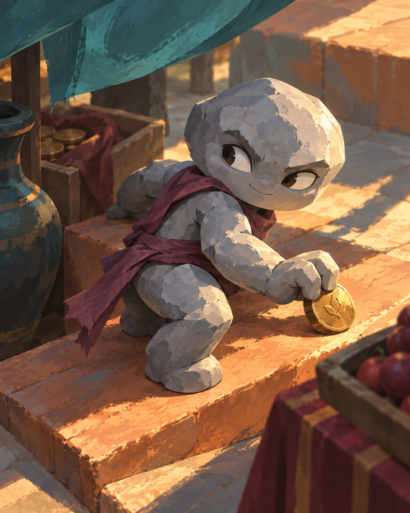
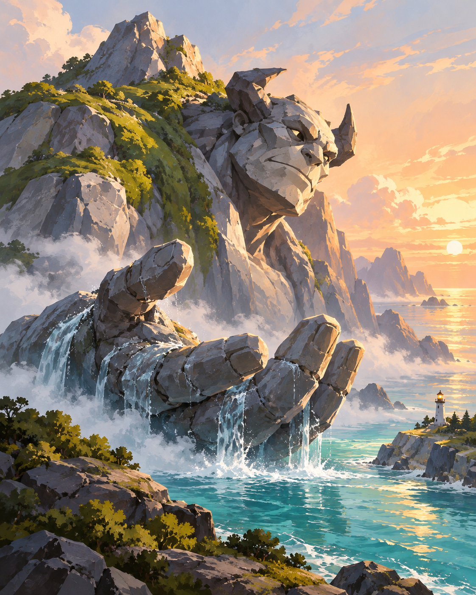
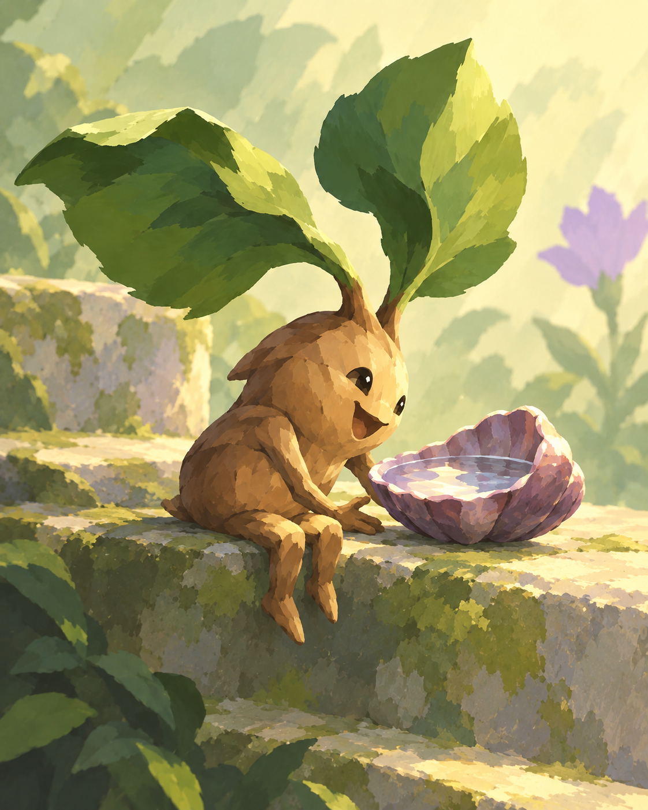
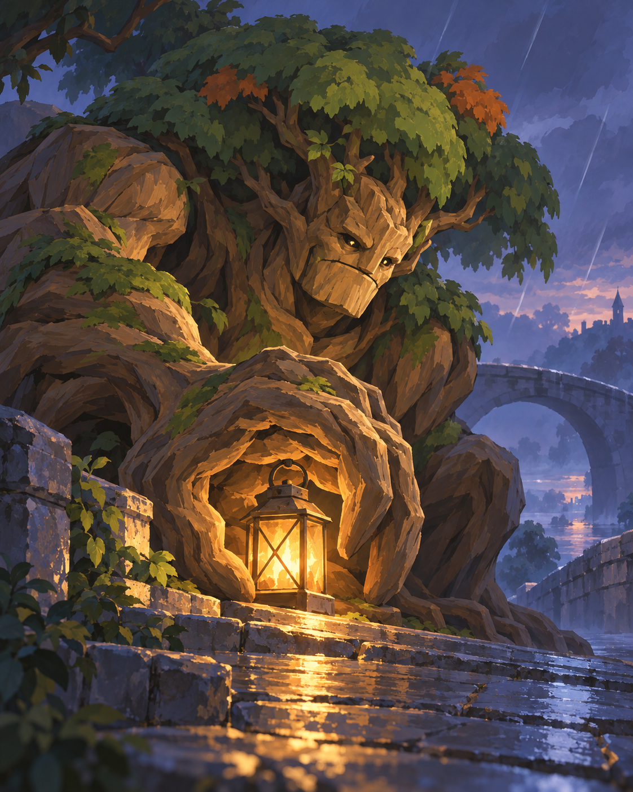
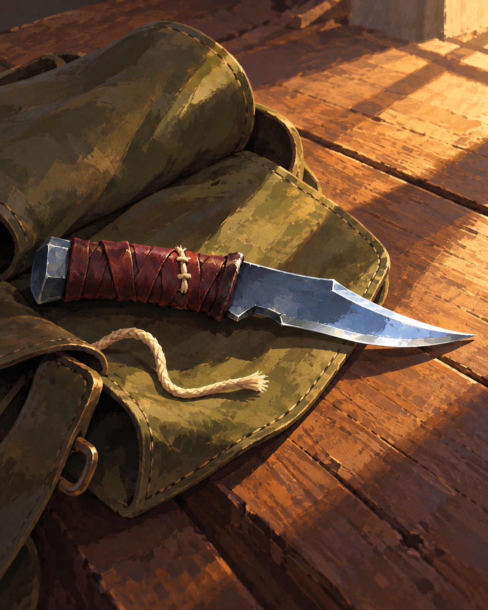
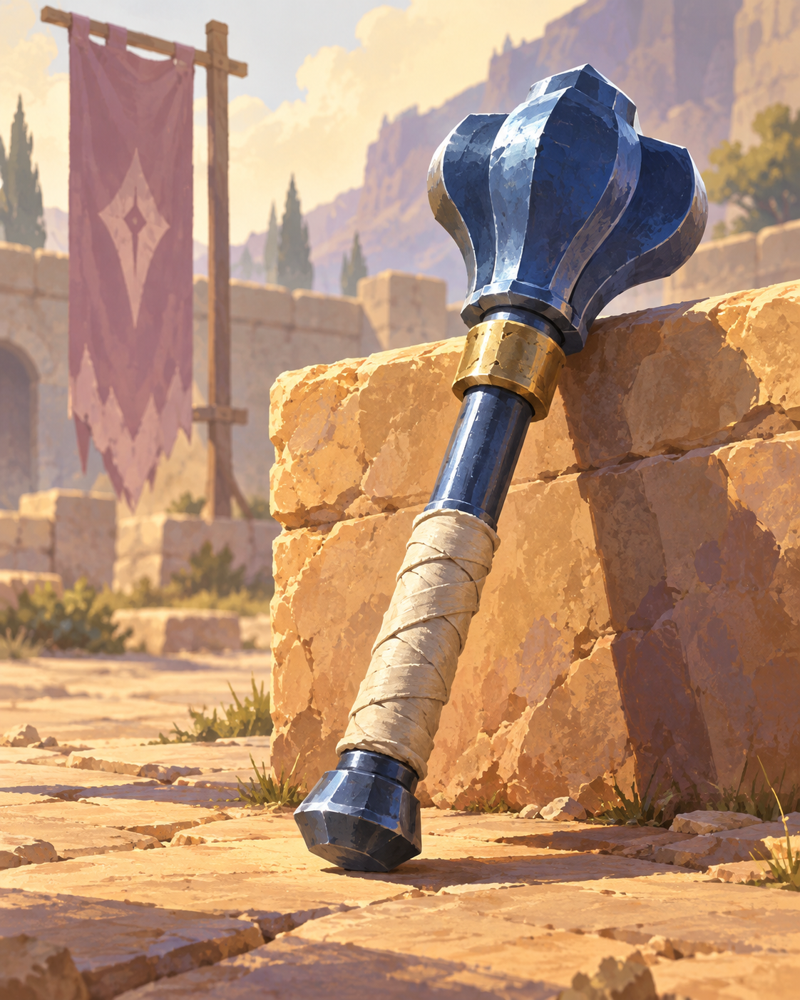
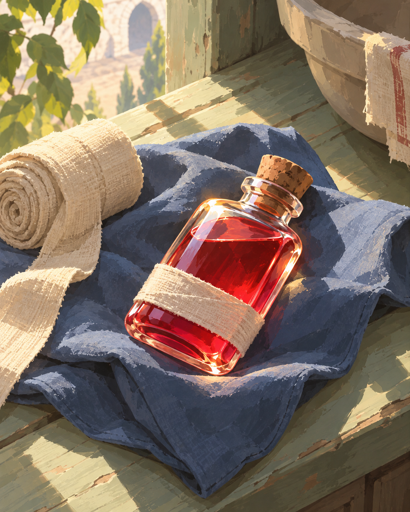
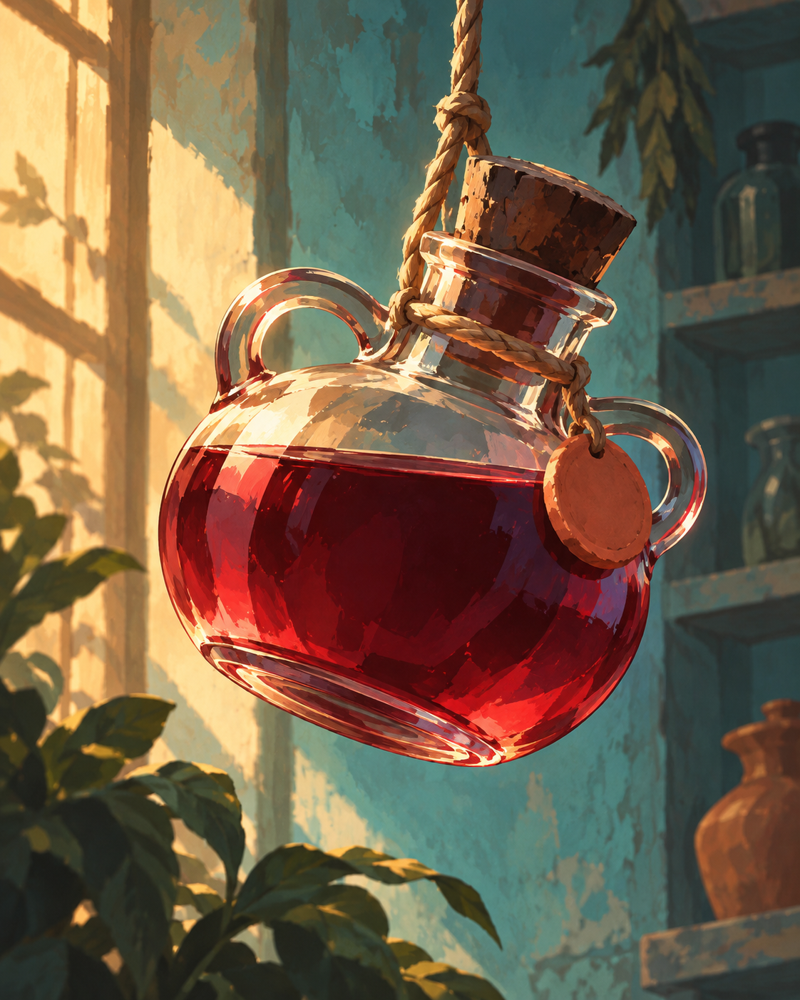

# Ash & Briar

The selected Scoundrel direction, revised on 2026-10-22 after reviewing official Runeterra illustrations. This catalog has 44 distinct names and 24 study images for 16 cards. The eight newest paintings revise the latest sample pair from each suit. The playable deck has not been changed.

## Current art direction

Keep expressive silhouettes and simple painted shapes. Give every illustration its own setting, lighting, supporting colors and memorable detail. Suit color belongs mainly to the subject or material: slate Stonekin, green Treefolk, blue-steel weapons and red healing liquids. Backgrounds can be warm, cool, light or dark. Avoid treating a suit as a monochromatic tint over an entire image.

The reviewed references show varied local colors within a shared visual world: [Greenglade Caretaker](https://dd.b.pvp.net/7_10_0/set1/en_us/img/cards/01IO019-full.png), [Inspiring Mentor](https://dd.b.pvp.net/7_10_0/set1/en_us/img/cards/01IO026-full.png), [Cithria of Cloudfield](https://dd.b.pvp.net/7_10_0/set1/en_us/img/cards/01DE039-full.png), and [Scarthane Steffen](https://dd.b.pvp.net/7_10_0/set1/en_us/img/cards/01FR045-full.png). These are visual observations, not copied scenes or character designs. The illustrations are provided through [Riot's official Data Dragon](https://developer.riotgames.com/docs/lor#data-dragon).

## All 44 names

Meaningful name words and material roots are distinct across the naming set. Linked names open the preferred available sample. Original generation names remain in the provenance when a study was renamed.

| Rank | Spades · Stonekin | Clubs · Treefolk | Diamonds · Weapons | Hearts · Potions |
| --- | --- | --- | --- | --- |
| 2 | [Pebble Sneak](samples-v3/2s.png) | [Sproutling](samples-v3/2c.png) | [Gutter Shiv](samples-v3/2d.png) | [Mender's Sip](samples-v3/2h.png) |
| 3 | Flint Scout | Bramble Skulker | Hooktooth | [Rosehip Tonic](samples/3h.png) |
| 4 | [Shale Sentry](samples/4s.png) | [Willow Watcher](samples/4c.png) | [Splitter Axe](samples/4d.png) | Hearth Cordial |
| 5 | Cobble Brawler | Hazel Guard | Wayfarer's Spear | Scarlet Draught |
| 6 | Slate Warden | Birch Seer | [Cobalt Mace](samples-v3/6d.png) | [Sanguine Brew](samples-v3/6h.png) |
| 7 | Cairn Keeper | Rootbound Shaman | Duelist's Saber | Ruby Elixir |
| 8 | Basalt Brute | [Oak Sentinel](samples-v3/8c.png) | Bellringer | Phoenix Tears |
| 9 | Quarry Hurler | Thornback | [Headsman's Greatsword](samples/9d.png) | [King's Remedy](samples/9h.png) |
| T | Obsidian Knight | Ironbark Champion | Oathbreaker | Second Dawn |
| J | Onyx Marshal | Briar Herald | — | — |
| Q | [Granite Matriarch](samples/Qs.png) | [Queen of Vines](samples/Qc.png) | — | — |
| K | Crag Sovereign | Elderbough | — | — |
| A | [The First Mountain](samples-v3/As.png) | The Verdant Dream | — | — |

## Weapon variety

| Card | Weapon type |
| --- | --- |
| Gutter Shiv | Improvised dagger |
| Hooktooth | Hooked sickle |
| Splitter Axe | Bearded axe |
| Wayfarer's Spear | Travel spear |
| Cobalt Mace | Flanged mace |
| Duelist's Saber | Dueling saber |
| Bellringer | Warhammer |
| Headsman's Greatsword | Executioner's greatsword |
| Oathbreaker | Chained flail |

Blue steel links the weapon suit while silhouettes, handles, material accents and settings vary. The names range across improvised tools, dueling, travel, ceremony and battle rather than repeating winter or sky imagery.

## Red potion range

| Card | Liquid color | Target |
| --- | --- | --- |
| Mender's Sip | Fresh scarlet | `#D94A45` |
| Rosehip Tonic | Rose red | `#C6546A` |
| Hearth Cordial | Brick red | `#A8443B` |
| Scarlet Draught | Vermilion red | `#D84B36` |
| Sanguine Brew | Deep garnet | `#882C44` |
| Ruby Elixir | Ruby wine | `#AE2E53` |
| Phoenix Tears | Copper red | `#C9503D` |
| King's Remedy | Dark cherry | `#982D3F` |
| Second Dawn | Coral red | `#DC6A60` |

All liquids remain recognizably red. Target hex values guide future paintings rather than specifying every pixel; highlights and transmitted light can vary. Shape, glass tint, closures, wrapping and surroundings also distinguish the bottles.

## Eight color-story revisions

Earlier paintings are preserved in [the original study gallery](earlier-studies.md). The revised images are saved separately in `samples-v3/`.

### 2♠ · Pebble Sneak

Cool slate body; terracotta ochre steps, muted teal awning, plum sash, brass coin.

### A♠ · The First Mountain

Grey granite and soft moss; turquoise sea, peach sky, lavender shade.

### 2♣ · Sproutling

Fresh green and honey wood; aubergine shell, pale mint garden and cream morning light.

### 8♣ · Oak Sentinel

Deep green canopy, warm ochre wood; russet patches, amber lantern, blue-violet mist.

### 2♦ · Gutter Shiv

Blue steel blade; burgundy leather, cream stitching, warm walnut and olive shadow.

### 6♦ · Cobalt Mace

Cobalt head; ivory grip wrap, brass collar, ochre sunlight and dusty mauve shadows.

### 2♥ · Mender's Sip

Bright fresh scarlet liquid; cream bandage, dusty blue cloth, pale sage morning light.

### 6♥ · Sanguine Brew

Deep garnet liquid; smoke-clear glass, copper light, pale turquoise wall, tan rope.

## Provenance

Created with the built-in image_gen tool. [catalog-and-prompts.json](catalog-and-prompts.json) contains current names, weapon types, potion color targets, original generation names, references, preferred-image flags and exact successful prompts. Sproutling uses its earlier illustration as an edit target; the other seven revised scenes use the original palette board as a style reference. Earlier versions are retained for comparison. No downloaded Runeterra artwork is included in the repository.
