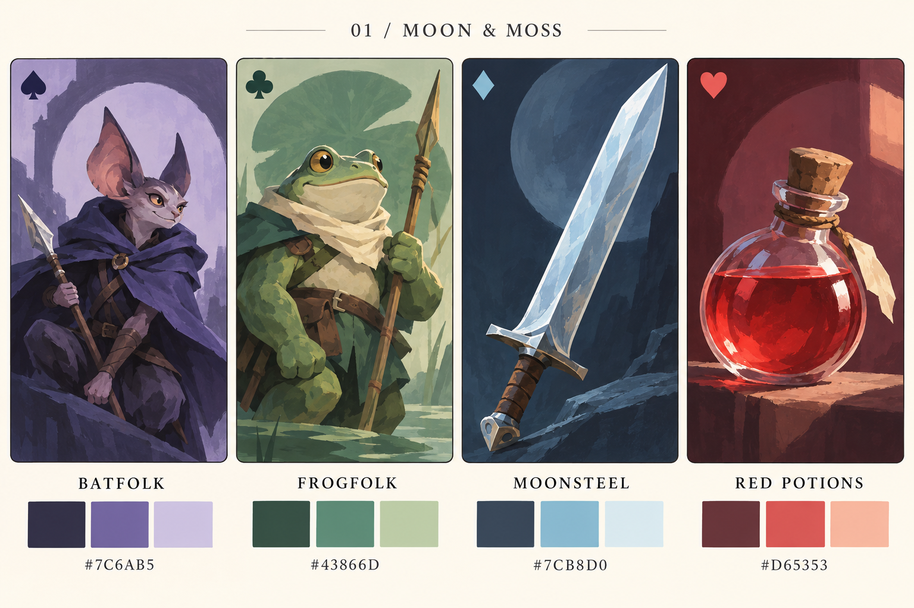
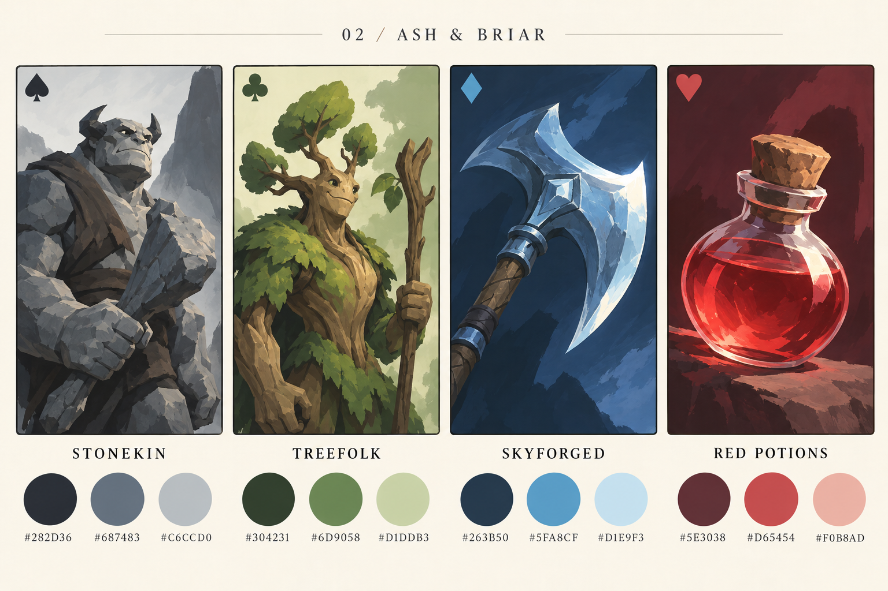
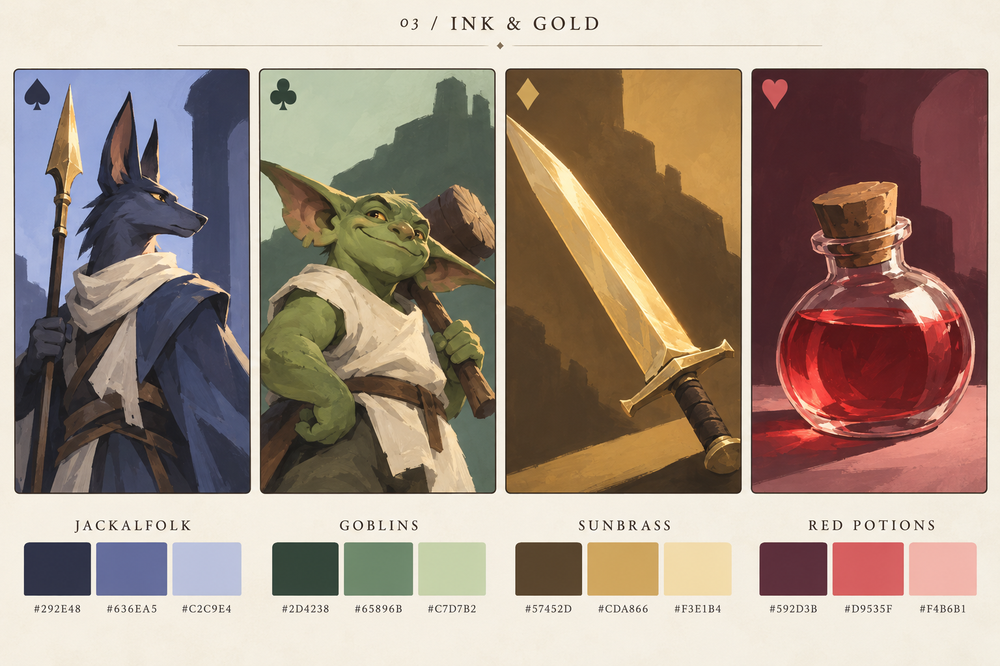

# Scoundrel palette and race exploration

**Selected direction:** the user chose **Ash & Briar**. The [full naming set and sixteen sample illustrations](../ash-and-briar/README.md) continue that direction.

Three concept boards generated on 2026-10-22 with the built-in image generation tool. These explore a simpler replacement art direction; the playable deck still uses Cinder & Tide. Exact prompts, palette targets and generation provenance are in [prompts.json](prompts.json). The painted colors and generated swatches approximate those targets.

| Direction | Spades: monsters | Clubs: monsters | Diamonds: weapons | Hearts: healing |
| --- | --- | --- | --- | --- |
| [Moon & Moss](moon-and-moss.png) | Violet batfolk `#7C6AB5` | Jade frogfolk `#43866D` | Icy moonsteel `#7CB8D0` | Ruby red `#D65353` |
| [Ash & Briar](ash-and-briar.png) | Slate stonekin `#687483` | Fern treefolk `#6D9058` | Blue steel `#5FA8CF` | Scarlet `#D65454` |
| [Ink & Gold](ink-and-gold.png) | Indigo jackalfolk `#636EA5` | Sage goblins `#65896B` | Honey brass `#CDA866` | Warm ruby `#D9535F` |

Moon & Moss is the recommended starting point: pointed bat ears and round frog bodies distinguish the monster suits even without color. Ash & Briar preserves the strongest visual connection to black spades and green clubs. Ink & Gold tests a warmer weapon palette while leaving red reserved for healing.

The races and palettes can be mixed. Batfolk and frogfolk could use the Ink & Gold palette if gold weapons feel better. Both monster suits have the same game rules; these are cosmetic identities.

## Simpler painting direction

- Use the expressive poses, focal lighting and painted shapes of the [official Runeterra illustration reference](https://playruneterra.com/en-sg/media), with original characters and much less surface detail.
- One subject, one prop and one broad background shape. Keep roughly 70% in the suit's color family, 20% neutral and 10% light or accent.
- Put sharp detail around the face or important item edge. Use broad, quiet shapes elsewhere; omit particles, ornate trim, busy scenery and tiny repeated textures.
- Use a consistent anatomy within each race. Create variety through body shape, age, pose, expression and role rather than making every rank a different species.
- Let lower ranks be scouts or apprentices, middle ranks be guards or specialists, court cards be leaders and aces be elders. Strength does not require more visual clutter.
- Keep potion liquid red at every value. Vary the vessel silhouette, fill level and stopper while preserving a strong readable red mass.
- Judge the final art at actual card size. Keep the suit symbol and value legible alongside the illustration so color is only one cue.

## Boards

